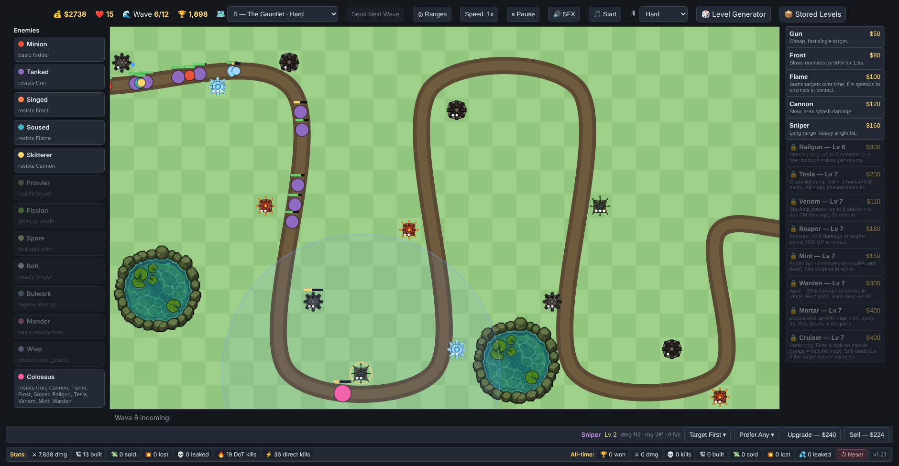
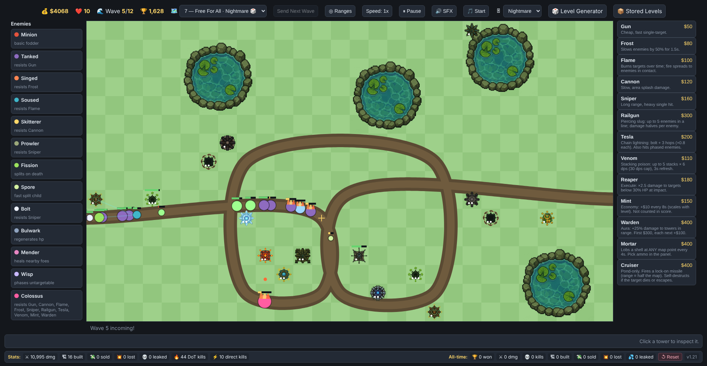
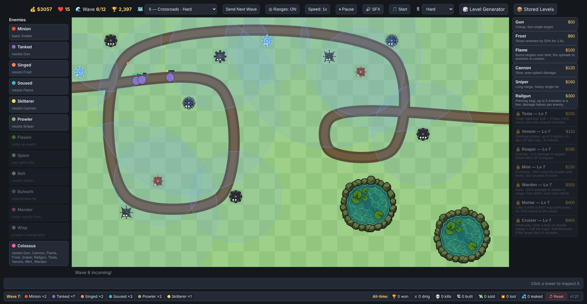
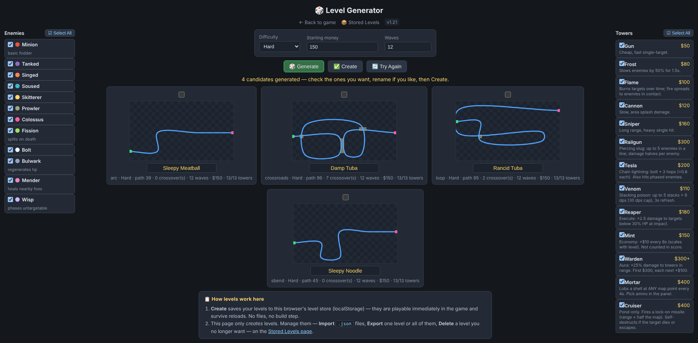

# Ratland Defense

### [Play it in your browser](https://github.mrrat.org/Ratland-Defense/)
by [MrRat Gaming](https://github.mrrat.org/) &nbsp;·&nbsp; [Discord](https://discord.gg/FybAhsxQHZ)

| | |
|---|---|
|  |  |
| *Custom levels unlock the full arsenal: Tesla, Venom, Reaper, Mint, Warden, Mortar and the pond-only Cruiser.* | *◎ Ranges shows every tower's reach at once; the bar below previews the next wave.* |

## What is a Tower Defense game?

In a tower defense game, enemies walk along a fixed path from a spawn point to your base. You can't move the enemies — you can only stop them by building towers on the tiles around the path. Towers shoot (or slow, burn, poison) enemies for as long as they're in range.

The loop is simple:

- Enemies are killed → you earn **money**
- Money buys and upgrades **towers**
- An enemy that reaches the end of the path **leaks** → you lose **lives**
- Survive every wave of the level to **win**; run out of lives to **lose**

The skill is in *placement* (where towers cover the most path) and *economy* (spending now vs. saving for something big).

## How this game works

### The map

- A 28×16 grid. The path is a smooth lane through it; enemies walk left to right.
- You build on **grass tiles only** — never on the path, and never on **ponds** (water tiles).
- Ponds appear on harder difficulties: `easy` 0, `normal` 1, `hard` 2, `nightmare` 4 ponds. The one exception to "no building on water" is the **Cruiser**, which can *only* be built on a pond.
- Every level starts **paused**. Press ▶ Resume (or `Space`) when you're ready.

### Money

- You start each level with a base amount ($100–$350 depending on the level).
- Kills pay a reward per enemy type (shown in the legend).
- **Send Next Wave early** = bonus money for every second of the 6-second countdown you skip.
- Selling a tower refunds **70%** of everything you invested in it (base cost + upgrades).
- Losing and retrying grants a growing bonus: +$50, then +$100, …
- Winning carries your unspent money into the next level — but the fraction kept depends on the *next* level's difficulty: `easy` 100%, `normal` 75%, `hard` 50%, `nightmare` 25%.
- **Speed bonus:** playing at 2× earns +20% income, 3× earns +40% (applies to kill rewards, Mint income and early-send bonuses — not to refunds or starting money).

### Lives & difficulty

- Each enemy that leaks costs lives (most cost 1; tanks cost 2, the boss costs 5).
- Starting lives come from the level's difficulty: `easy`/`normal` 20, `hard` 15, `nightmare` 10.
- The 🎚 difficulty dropdown lets you replay any level at any intensity. It changes wave size, spawn speed, enemy HP, your starting lives and how often the boss shows up.

### Waves

- Built-in levels have **12 waves**; custom levels can have up to 50.
- Waves auto-start 6 seconds apart, or hit **Send Next Wave** for bonus money.
- The bar under the map previews exactly which enemies are in the next wave (swatch + count). During a wave it shows your live level stats instead.
- Enemy HP scales up every wave, so early waves are a warm-up.

### Towers: upgrading & selling

- Click a placed tower to open its panel: **targeting mode**, **Upgrade**, **Sell**.
- Towers have 3 levels. Upgrading costs the base cost ×1 (to L2), then ×1.5 (to L3). Each level scales damage, range and fire rate up.
- Targeting modes: `First` (furthest along the path — default, usually best), `Last`, `Closest`, `Strongest` (highest HP).
- **Friendly fire is real:** your own projectiles can hit your own towers. Towers have HP equal to 2× everything invested in them. Homing shells that clip a tower are destroyed and damage it; Railgun slugs punch straight through towers. The support towers (**Frost** and **Warden**) are immune to friendly fire.

### Scoring

Score = `kills × 10 + lives × 50 + money earned × 1`. Your best score per level is saved. Mint income does *not* count toward money earned, so it doesn't inflate your score.

## The Towers

Towers unlock as you progress through levels. The first six are available on the built-in maps; the rest (level 7+) appear on custom levels made in the Level Generator.

- **Gun** — $50 · L1
Cheap, fast single-target (12 dmg, 2.5 shots/s). Your first line of defense. Weak vs. Tanked enemies, which resist it.
- **Frost** — $80 · L2
Slows enemies 50% for 1.5s. Tiny damage, but slows are what make every other tower hit harder. Slowing a **Wisp** also pauses its phase cycle.
- **Flame** — $100 · L3
Burns targets: 14 dmg/s for 2.5s. Fire **spreads** to any enemy within touching distance of a burning one, so it melts packs. The burn beats **Bulwark**'s regeneration. Weak vs. Soused enemies.
- **Cannon** — $120 · L4
Slow but hits an area (55px splash). Your answer to swarms and anything that dodges single-target shots (phased Wisps, splitting Fissions). Weak vs. Skitterers.
- **Sniper** — $160 · L5
Very long range (260), heavy single hit (70 dmg). Great for picking off tanks from a distance. Weak vs. Prowlers and Bolts.
- **Railgun** — $300 · L6
Fires a piercing slug through up to 5 enemies in a line; damage halves per enemy it passes (70 → 35 → 17.5 …). Place it where the path runs straight and parallel lanes stack up.
- **Tesla** — $200 · L7
Chain lightning: hits its target, then arcs to up to 3 more nearby enemies (×0.8 damage per hop). **One of the few ways to hit phased Wisps directly.**
- **Venom** — $110 · L7
Stacking poison: each hit adds a stack, up to 5 × 6 dmg/s = 30 dmg/s, refreshed for 3s. Poison ignores **Bulwark**'s regen and ticks through Wisp phases. Cheap DoT engine.
- **Reaper** — $180 · L7
Execute: any target below 30% HP takes ×2.5 damage at impact (40 → 100). The finisher that cleans up whatever else is dying — and one of only two towers that hurts the boss.
- **Mint** — $150 · L7
Pure economy: +$10 every 8s (scales with level). It never fights, and its income doesn't count toward score. Build it when you're rich enough to afford a second income stream.
- **Warden** — $300 (+$100 each extra) · L7
Aura: +25% damage to every tower inside its range, and the effects stack *multiplicatively* (two Wardens covering the same tower = ×1.5625). Expensive per unit, so cluster your kill zone around it.
- **Mortar** — $400 · L7
Dumb artillery: lobs a shell at **any tile on the map** (you pick the impact point; it can even land between two lanes) every 4s, with a 112px blast. The shell carries the stats of an ammo type you choose in its panel: Cannon, Flame, Frost, Tesla or Venom. **No enemy resists mortar damage**, and its slow/burn/poison payloads apply at full strength — it is the universal counter.
- **Cruiser** — $400 · L7
Pond-only missile tower. Fires a lock-on homing missile with half-the-map range (700px) for 225 damage — about a quarter of the boss's HP in one hit. If its target dies or escapes range before impact, the missile self-destructs for nothing.

## The Enemies

The legend on the left of the screen lists every enemy type that can appear on the current level (dimmed ones aren't in this level's pool).

- **Minion** — basic fodder. Cheap, steady, no tricks.
- **Tanked** — slow and beefy (3.5× minion HP), costs 2 lives if it leaks. **Resists Gun.**
- **Singed** — normal stats but **resists Frost**, so slows wear off much faster on it.
- **Soused** — normal stats but **resists Flame**; burn damage and duration are both cut.
- **Skitterer** — fast (120 speed) and fragile. **Resists Cannon** splash.
- **Prowler** — quick, **resists Sniper**.
- **Colossus (boss)** — huge: 900 HP, very slow, costs 5 lives, pays $120. It resists *every* tower except the **Mortar** and the **Reaper** — those two are its only real weaknesses. Boss waves come with escorts, and the music changes while it's on screen.
- **Fission** — splits into **2 Spores** at its position when it dies. You can't avoid the split; you have to budget for the children too.
- **Spore** — the fast (135 speed) split child. Never spawns from waves, only from Fissions. Tiny HP, but they swarm.
- **Bolt** — cycles: walks slowly for 2.5s, then dashes at 170 speed for 1s. **Resists Sniper.** Slows affect both phases, so Frost still works.
- **Bulwark** — 220 HP and **regenerates 6 HP/s**. Slow damage that can't out-heal it will never kill it; use Flame burn (14 dps) or Venom poison (up to 30 dps).
- **Mender** — heals nearby enemies (within 90px) at 8 HP/s, but not itself. It makes whole packs tanky: **kill it first** (target a tower with `Strongest` mode near it, or let splash/execute take it out early).
- **Wisp** — alternates solid (2.5s) and phased (1.2s). While phased it's **untargetable** by direct shots — but splash (Cannon, Mortar), burn (Flame) and chain (Tesla) all still hit it. Frost slow pauses the phase cycle, freezing it in whatever state it's in.

### The resistance system

Each enemy that "resists" a tower takes reduced damage from it — and the reduction grows with the map level (+4% per level, capped at 80%). By late levels, a resisted tower is nearly useless against its match-up. Two rules follow:

1. **Diversify.** Don't build your whole defense around one tower type.
2. **Mortar payloads are immune.** No enemy resists the `mortar` source type, so Mortar shells and their DoTs always land at full strength — it's your safety valve against any resistance wall.

## Tower ↔ Enemy cheat sheet

- **Colossus** → Mortar (any ammo) + Reaper execute. Everything else barely scratches it.
- **Bulwark** → Flame burn or Venom poison (both out-DPS its 6/s regen).
- **Wisp** → Cannon/Mortar splash, Flame burn, Tesla chain; Frost to freeze its phase cycle.
- **Mender** → kill it before it heals the pack — Reaper's execute is ideal once it dips below 30%.
- **Fission + Spores** → splash (Cannon, Mortar) or fast single-target (Gun, Railgun) for the children.
- **Skitterer / Bolt / Prowler (the fast ones)** → Frost slow in front of your damage towers; Cannon for Skitterers, avoid Sniper-heavy setups vs. Prowlers/Bolts.
- **Tanked** → anything except Gun: Sniper, Railgun, Reaper, Mortar.
- **Singed / Soused** → simply don't rely on Frost or Flame against them; swap in your other damage sources.

## Levels & difficulty

The six built-in levels, in order:

1. **Snake** — easy
2. **Serpentine** — easy
3. **Comb** — normal
4. **Zigzag** — normal
5. **The Gauntlet** — hard
6. **Crossroads** — hard (two crossing lanes)

- Use the 🗺️ dropdown to replay any unlocked level; the 🎚 dropdown sets its difficulty (the choice is remembered per level).
- The 🎲 **Level Generator** page builds custom levels: pick a path shape, which enemies and which towers appear, difficulty and wave count. Custom levels always unlock, and they're where the level-7 towers (Tesla, Venom, Reaper, Mint, Warden, Mortar, Cruiser) live.

  

- The 📦 **Stored Levels** page lists your custom levels with mini-maps; export/import them as `.json` files to share with friends or back up.

## Tips for new players

- Start with 2–3 Guns on the first long straight, then add a Frost in front of them. Slows are the cheapest DPS multiplier in the game.
- Watch the **next-wave preview** bar: if a big tank or boss wave is coming, bank money and upgrade before it starts instead of over-building now.
- Sending waves early is free money — do it whenever your towers are clearly winning the fight.
- Running at 2×/3× earns more per kill; use it when you're confident, drop back to 1× for boss waves where one leaked life hurts.
- Cluster damage towers inside a **Warden**'s aura ring (toggle ◎ Ranges to see every tower's range at once).
- If you keep losing, retry: each attempt adds +$50 starting money, and your tower layout knowledge is the real bonus.
- A first-time 3-step tutorial appears on your very first load — it teaches pick / build / resume.

## License

Copyright (c) 2026 MisterRat. Free for noncommercial use under the [PolyForm Noncommercial License 1.0.0](https://polyformproject.org/licenses/noncommercial/1.0.0). Commercial use requires written permission. See `LICENSE`.
